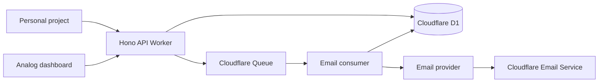
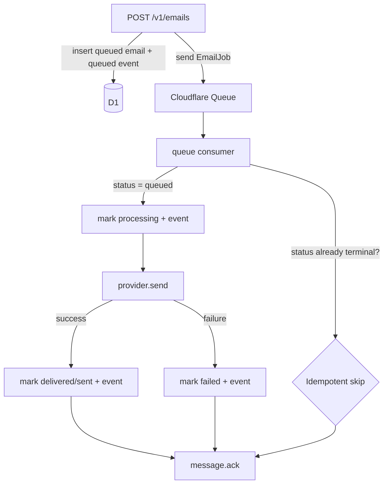

# Architecture

## Overview



Today, `Project` and `Dashboard` both call the same local Hono Worker (`localhost:8787`), which is
itself the queue consumer (one Worker script exports both `fetch` and `queue`). `Provider` is the
`MockEmailProvider` by default; `CloudflareEmailProvider` is implemented and selectable but unused
locally.

## Monorepo structure

```text
apps/
  dashboard/    Analog (Angular 21, zoneless) static SPA — Vite build, no SSR
  api/          Hono Cloudflare Worker — ES modules format, `fetch` + `queue` exports
packages/
  contracts/         Zod schemas + inferred types — the single source of truth for API shapes
  database/          D1 migrations, repositories (typed query functions), seed data generator
  email-core/         Provider interface, template rendering, status lifecycle, processing service
  email-templates/    Built-in template content (welcome, email-verification, project-notification)
  sdk/                Typed client wrapping the HTTP API, built on `contracts`
  typescript-config/  Shared tsconfig bases (library / worker / angular)
  eslint-config/       Shared eslint flat configs (base / worker / angular)
```

Dependency direction is strictly one-way: `apps/*` depend on `packages/*`; packages never depend on
apps. Within packages, `database` depends on `email-core` and `email-templates` only for its seed
generator (`packages/database/src/seed.ts`, exposed via the `@andersseen/database/seed` subpath
export) — the repository/mapper code that the API uses at request time has no such dependency.

## HTTP request flow

1. A request hits the Worker's `fetch` handler (`apps/api/src/index.ts` → `app.ts`).
2. Global middleware runs in order: request ID generation, structured JSON request logging, CORS
   (scoped to the dashboard's local origin), then the global error handler is registered.
3. `/health` is public. Everything under `/v1/*` passes through `authMiddleware`, which resolves a
   Bearer token to a project via `ApiKeyAuthProvider` (see below) and sets `projectId` on the
   request context.
4. Route handlers (`apps/api/src/routes/*.ts`) validate input with Zod (via a small
   `validate()` wrapper around `@hono/zod-validator` that normalizes failures into the shared
   `ApiError` envelope), then call `packages/database` repository functions — no raw SQL and no
   business logic lives in the route handlers themselves.
5. `POST /v1/emails` additionally resolves a template (if one was requested), renders it with
   `packages/email-core`'s `renderTemplate`, inserts the email as `queued`, and sends an `EmailJob`
   (`{ emailId, projectId }`) to the Cloudflare Queue.
6. Every response follows the shared `contracts` schemas; the dashboard and SDK parse responses
   against those same schemas, so a shape drift fails loudly on both ends instead of silently.

## Queue processing flow



The consumer (`apps/api/src/queue.ts`) is a thin adapter: it validates each message body with Zod,
builds an `EmailProcessingStore` (`apps/api/src/lib/processing-store.ts`, backed by
`packages/database`) and an `EmailProvider` (mock or Cloudflare, selected by `EMAIL_PROVIDER`), and
delegates all lifecycle logic to `packages/email-core`'s `processEmailJob`. That function is what
makes processing idempotent: it loads the email, and if its status isn't `queued` it's a no-op —
so a redelivered queue message (or two people clicking "retry" at once) can never double-send or
double-transition an email. Business-level outcomes (`delivered`, `failed`) are both terminal and
always acked; only unexpected exceptions (e.g. a D1 outage) call `message.retry()`.

Local Cloudflare Queues are simulated in-process by Miniflare (bundled with Wrangler 4), so
`wrangler dev` runs the producer and consumer together with no extra setup or fallback needed.

## Database entities

| Table          | Purpose                                                                                                                                                                                             |
| -------------- | --------------------------------------------------------------------------------------------------------------------------------------------------------------------------------------------------- |
| `projects`     | Single row today (`andersseen-personal`); every other table scopes to a `project_id` so teams/multi-tenancy can be added later without a migration.                                                 |
| `api_keys`     | Stores only a `prefix` (for display) and `key_hash` (SHA-256) — never a plaintext key. Seeded with one row representing the local dev key; not yet used for authentication (see below).             |
| `templates`    | `subject`/`html`/`text` contain `{{variableName}}` placeholders; `variables` stores the example values shown in previews and used to seed the Send Email form.                                      |
| `emails`       | One row per send. Array/object fields (`to_addresses`, `variables`, ...) are stored as JSON strings and (de)serialized in `packages/database/src/mappers.ts`. `status` follows the lifecycle below. |
| `email_events` | Append-only audit trail per email (`queued` → `processing` → `sent`/`delivered`/`failed`), rendered as the timeline on the email details page.                                                      |

Email status lifecycle (`packages/contracts/src/email-status.ts`):

```text
queued → processing → sent → delivered
                    ↘ failed        ↘ failed
```

`canTransitionEmailStatus` encodes the allowed edges; nothing in the codebase moves an email
backwards or transitions a terminal (`delivered`/`failed`) email again.

## Provider abstraction

```ts
interface EmailProvider {
  send(message: RenderedEmail): Promise<EmailProviderResult>;
}
```

- `MockEmailProvider` (default, `EMAIL_PROVIDER=mock`): resolves instantly with a fake
  `mock_<uuid>` message ID, and deterministically throws for any send where `fail@example.com`
  appears in `to`/`cc`/`bcc` — the one lever the dashboard/SDK/tests use to exercise the failed
  path without any external dependency.
- `CloudflareEmailProvider` (`EMAIL_PROVIDER=cloudflare`): calls the `send_email` Workers binding
  (`env.EMAIL.send({...})`) directly with JSON — Cloudflare's current recommended API, not the
  legacy MIME/`EmailMessage` path. Prepared and wired into `wrangler.jsonc`, but not exercised
  locally since it requires a real onboarded sending domain.

Both are selected by `apps/api/src/lib/provider-factory.ts` purely from `env.EMAIL_PROVIDER`, so
switching providers never touches route or queue-processing code.

## Authentication abstraction

```ts
interface ApiKeyAuthProvider {
  authenticate(rawKey: string, env: Env): Promise<AuthResult | null>;
}
```

`DevApiKeyAuthProvider` (`apps/api/src/lib/auth-provider.ts`) is the only implementation today: it
compares the Bearer token against `env.ANDERSEND_API_KEY` and resolves the single seeded project.
The `api_keys` table and its repository functions (`hashApiKey`, `listApiKeys`,
`getActiveApiKeyByPrefix`, `touchApiKeyLastUsed`) already exist so a future
`DbApiKeyAuthProvider` — hashing the incoming key and looking it up in D1 — can replace this
without touching `authMiddleware` or any route.

## Dashboard / API separation

The dashboard never talks to D1 or constructs SQL — it only calls `@andersseen/sdk`, which is a
thin, provider-agnostic `fetch` wrapper validating every request/response against
`@andersseen/contracts`. `ApiClientService` (`apps/dashboard/src/app/core/api-client.service.ts`)
is the single place the SDK is instantiated; every page injects it and calls
`api.client.<resource>.<method>()` — there are no hardcoded arrays standing in for API data
anywhere in the dashboard. The one exception where a package is reused directly rather than
through the API is the template editor's live preview, which imports `renderTemplate` from
`@andersseen/email-core` to reflect _unsaved_ edits client-side (the server's preview endpoint can
only render what's already stored).

Responsibility split for the dashboard's UI ecosystem:

- **Volt UI** (`@voltui/components`) — every discrete styled control: buttons, cards, inputs,
  selects, badges, tabs, dialogs/drawers, tables, pagination, form fields.
- **Quartz Headless** (`quartz-headless`) — orchestration Volt doesn't own: the toast queue
  (`ToastService`, rendered through Volt's own `<volt-toast>` parts so the styling still comes from
  Volt), advanced tooltips, overlay positioning.
- **Angular Movement** (`angular-movement`) — entrance/stagger animations on lists and stat tiles
  (`moveEnter`, `moveStagger`); disabled globally when `prefers-reduced-motion: reduce` matches.
- **Lumen Icons** (`lumen-icons`) — the only icon source used anywhere in the dashboard.

## Production architecture

`apps/api` has a `production` Wrangler environment (README.md "Production deployment (API)" has
the exact commands):

- One Worker (`andersend-api-production`) on the custom domain `api.mail.andersseen.dev`, bound to
  a real D1 database, the `andersend-emails` Queue, and the `send_email` binding with
  `EMAIL_PROVIDER=cloudflare` (successful hand-off → status `sent`; no delivery webhooks yet).
- Authentication is database-backed only (`and_<id8>_<secret>` keys, minted with
  `pnpm api-key:create --remote`); the env dev key and the seeded `and_dev_` key are refused, and
  `/v1/dev/*` returns 404.
- Callers are other projects' servers (e.g. a contact-form endpoint). The deployed dashboard is
  not pointed at it yet — that needs a dashboard login so no key ships in a static bundle.
- Everything else — contracts, the queue-processing logic, the provider abstraction, the schema —
  was already production-shaped; deployment was a configuration change, not a rewrite.
